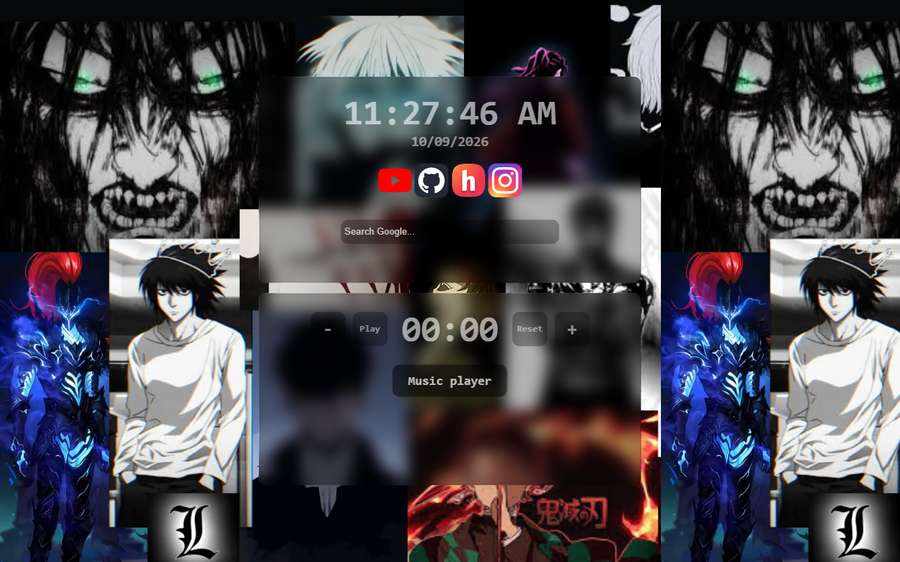

# New Anime Tab

ok so I got Bored of the Empty Chrome tab (vry plain lookinh) and made This Anime themed tab (yk that the real reason was stardance mission btw ywahh) thats Pretty much the Whole idea lol +_+

### live At: [animetab.techxtreme.me](https://animetab.techxtreme.me)



the Time is 12hr WITH Seconds and the Date just sits under it Four icons or apps u can sayy yt, Github, Myy Stardance and Insta. Search is Google you Type and hit Enter like ur normal Google Searchbar

Also theres a Timer under the clock too (Plus minus Play reset r the options) When it hits 00:00 it BEEPS and a Red Stop Timer Shows up Click that or it just Keeps going forever... T-T

Music Player is the Button Under the Timer. U can Drag 10 Songs from Soundhelix Same site i Use on my Other stuff, Open Spotify puts the embed in and the Button Turns into Close Spotify so that u can close the embed. X Hides the window rather than completely closing it soo If spotify is On it KEEPS playing which is kinda the Point red Stop Next to the X kills Both properly :D

old Wavs are Still in public/tunes I just Dont use them cuz ngl they Sounded bad, I mean pretty bad :p

If you Wanna run it you need Node

```
npm install
npm run dev
```

then http://localhost:5173

for a Real new Tab go Chrome Settings on startup, Open a Specific page and Paste the link to Animetab.techxtreme.me or to ur own varient :)

### Stardance page https://stardance.hackclub.com/projects/65089

## MADE BY ATHANNN (Atharva) :D